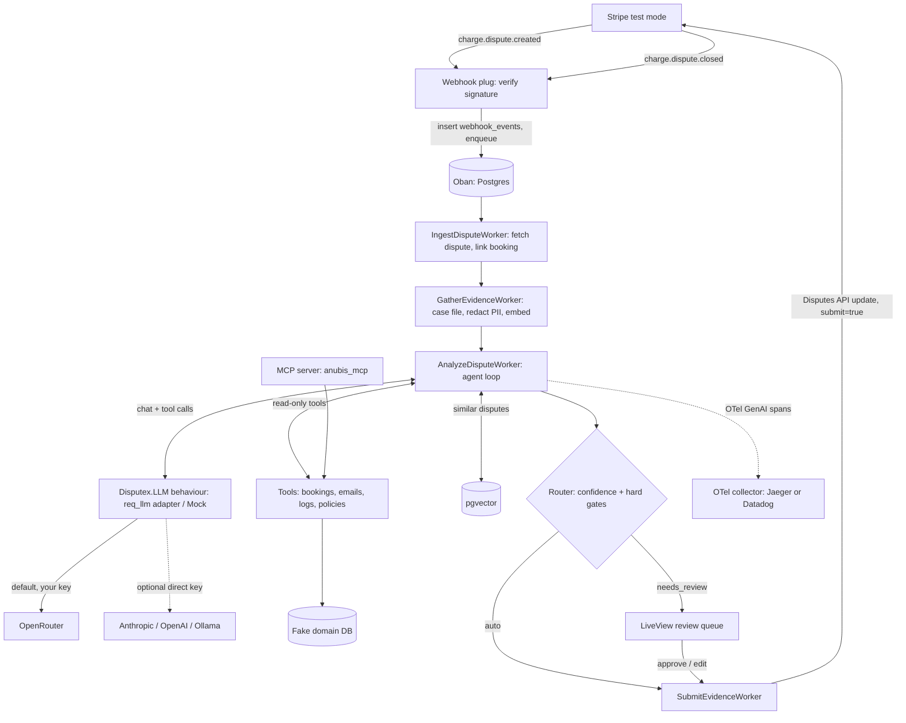

# Chargeback dispute agent in Elixir

A two-weekend, self-hosted open-source app. One `docker compose up` brings up Phoenix, LiveView, and Postgres with pgvector. An Oban pipeline plus an LLM agent drafts Stripe dispute responses, routes low-confidence cases to a LiveView review queue, and ships with an eval suite, OpenTelemetry cost tracing, and an MCP server. Users bring their own OpenRouter key through `req_llm`. Library versions were checked on Hex on 24 Oct 2026.

The working name in the original notes was `disputer`. This repository is `disputex`: OTP application `:disputex`, modules `Disputex.*` and `DisputexWeb.*`.

Sources: [req_llm](https://hex.pm/packages/req_llm), [instructor](https://hex.pm/packages/instructor), [instructor_lite](https://hex.pm/packages/instructor_lite), [anubis_mcp](https://hex.pm/packages/anubis_mcp), [hermes_mcp](https://hex.pm/packages/hermes_mcp), [Stripe disputes API](https://docs.stripe.com/disputes/api), [Stripe testing](https://docs.stripe.com/testing).

## Milestone 1 notes

Milestone 1 (the "Weekend 1, Saturday" checklist) is implemented. Later sections describe the whole system. These choices are already in the code and override the sketches below where they differ:

- `req_llm` is not a dependency yet. `config/runtime.exs` still loads the LLM environment so milestone 2 can attach an adapter without another secrets pass.
- `Disputex.Payments` is the behaviour tests mock. `Disputex.LLM` does not exist yet.
- `disputes.embedding` is `vector(1536)` with an HNSW cosine index. Gather writes the redacted case file and leaves the vector empty.
- `agent_runs.decision` is a `:map`. The typed `Decision` embed arrives with the agent.
- `setup.sh` is non-interactive. It copies `.env.example` and generates `SECRET_KEY_BASE`, `VAULT_KEY`, and `MCP_TOKEN`. It does not prompt, and it does not create `ADMIN_PASSWORD` (there is no auth yet).
- Boot refuses both `sk_live_` and `rk_live_` unless `ALLOW_LIVE=true`.
- `STRIPE_API_BASE_URL`, when set, overrides stripity_stripe's API host so a mock can stand in for Stripe.
- Stored webhook payloads keep the event envelope and dispute identifiers. Evidence and payment-method blobs are dropped; the worker re-fetches Stripe.
- Gather jobs are unique only while in flight, so a later deliberate re-gather is not blocked forever. Ingest jobs are unique on the Stripe event id for every state.
- The container speaks HTTP. `force_ssl` is off so Stripe CLI can forward to `app:4000` on the Compose network. The host port is bound to `127.0.0.1`.
- Dialyzer is not in CI.
- Elixir 1.20.4 and OTP 29.1.2 are pinned in the image and in GitHub Actions. They were not in the original package table. They are the current stable pair with a published `hexpm/elixir` Debian image on 24 Oct 2026.

## Decisions log

| # | Decision (24 Oct 2026) | Consequence |
| --- | --- | --- |
| 1 | Self-hosted open-source application, not a library | One `docker compose up` brings up Phoenix, LiveView, and Postgres/pgvector. Multi-stage mix release. Seeded demo data. A first-run setup page comes later. |
| 2 | Bring your own LLM key | Keys come only from env vars, `.env`, or Docker secrets on the user's machine. The project never holds, proxies, or stores keys centrally. |
| 3 | `req_llm` 1.29.0+ is the LLM client | One production adapter behind `Disputex.LLM`. Tool calling, usage, USD cost, telemetry, and OpenTelemetry come from req_llm. Not wired in milestone 1. |
| 4 | OpenRouter is the default provider | Model strings `openrouter:<author>/<model>` with `OPENROUTER_API_KEY`. Direct `anthropic:` / `openai:` / `ollama:` keys are a config switch. Evals compare many models with one key. |

## Goal

Ship a small, production-shaped AI system that a hiring manager can clone, run with `docker compose up`, and judge in ten minutes. The domain is Stripe disputes for travel bookings. The novelty is the AI engineering: a tool-calling agent, typed output, evals, cost and latency tracking, human review, and MCP.

| | |
| --- | --- |
| Working name | `disputex`, MIT |
| Form | Self-hosted application shipped as a Docker image and `docker-compose.yml`. Not published to Hex. |
| LLM access | Bring your own key. `req_llm` 1.29.0+ with OpenRouter by default. Direct provider keys are optional. |
| Target CV line | Built an open-source, self-hosted LLM agent in Elixir that automates Stripe chargeback disputes: N% decision accuracy on a 30-case eval set at X cents and Y s p95 per dispute, with human review below a calibrated confidence threshold. |
| Proof artifacts | README results table from `mix disputex.eval`, a demo GIF, a trace screenshot, a blog post. |
| Done when | On a clean machine, `./setup.sh` and `docker compose --profile stripe up`, plus an OpenRouter key and a Stripe test key, are enough for a dispute created with `pm_card_createDispute` to flow to a submitted or human-approved response, and the eval table is in the README. |

## Prior art

| Project | Stack | What it does |
| --- | --- | --- |
| OpenAI cookbook: dispute agent | Python, Agents SDK | Triage, acceptance, and investigator agents over Stripe tools. A notebook. No evals, no review UI. |
| alexander-zuev/riposte | TypeScript, Cloudflare Workers | Autonomous Stripe dispute agent, AGPL-3. |
| ArhntBhura/AI-Risk-Manager | Python, LangGraph, pgvector | Win-likelihood score, rebuttal draft, verifier crew, always human approval. |
| MerchantGuard/agentguard-cb | SDK | Deterministic Visa CE 3.0 evidence packaging, no LLM, stages with `submit=false`. |
| qubitonhq/qubiton-stripe-dispute-evidence | Node | Builds evidence packets from webhooks and calls `disputes.update`. |

A GitHub search on 24 Oct 2026 for chargeback or Stripe dispute projects in Elixir returned nothing. The differentiators to state once the agent exists: an Elixir/OTP implementation; a self-hosted app with the user's own OpenRouter key; a durable Oban pipeline; Ecto-validated typed output with citation checks; a reproducible eval harness; OpenTelemetry GenAI spans; an MCP server over the same tools; a calibrated auto-submit gate.

## Stack and verified versions

Checked on Hex on 24 Oct 2026. `mix.lock` pins these releases. Requirements in `mix.exs` use `~>`.

| Concern | Package | Version | Why |
| --- | --- | --- | --- |
| Runtime | Elixir / OTP | 1.20.4 / 29.1.2 | Current stable pair with a `hexpm/elixir` Debian image |
| Web and UI | `phoenix` / `phoenix_live_view` | 1.8.16 / 1.2.13 | Review queue, PubSub |
| Jobs | `oban` | 2.24.2 | Durable steps, retries, uniqueness, a queue limit for LLM calls |
| LLM client | `req_llm` | >= 1.29.0 | Milestone 2. One API over OpenRouter, Anthropic, OpenAI, and Ollama |
| Default gateway | OpenRouter via req_llm | | One `OPENROUTER_API_KEY` reaches many models |
| Packaging | `mix release`, Docker, Compose | | `pgvector/pgvector:pg17`, Debian `trixie-20261020-slim` |
| Typed output | Ecto embedded schema, optional `instructor_lite` | 1.3.0 | Changeset validation and a re-ask. Milestone 2 |
| Vectors | `pgvector` | 0.4.2 | `Pgvector.Ecto.Vector`, cosine search |
| Stripe | `stripity_stripe` | 3.3.2 | Disputes API, `Stripe.WebhookPlug` |
| Tracing | `opentelemetry` family | 1.5.0 | Later milestone |
| MCP | `anubis_mcp` | 2.2.0 | Later milestone. LGPL-3.0, fine as a dependency of an MIT app |
| Tests | `mox`, `stream_data` | 1.3.2 / 1.4.0 | Behaviour mocks, redaction properties |

`instructor` (instructor_ex) last released 0.1.0 on 9 Feb 2025. The maintained successor is `instructor_lite` 1.3.0. The agent will use req_llm for transport and a small Ecto-schema contract for typed output. `langchain` 0.15.5 is a reasonable alternative; a hand-written loop over a behaviour is easier to test and to explain.

## Scope

In scope for the finished app:

- Self-hosted: `docker compose up` runs Phoenix, LiveView, and Postgres/pgvector, with seeded demo data and a first-run setup page.
- Bring-your-own-key LLM access through `req_llm`: OpenRouter by default, direct keys or local Ollama by config.
- `charge.dispute.created`, `.updated`, and `.closed` in Stripe test mode.
- Seeded hotel-booking domain: customers, bookings, stays, emails, access logs, policies.
- Agent loop with read-only tools and a terminal `submit_decision` tool.
- Typed decision: reason, action, confidence, evidence list, draft, risk flags.
- Routing policy and LiveView review, edit, approve, reject.
- Text evidence submitted through the Disputes API.
- Eval suite of 30 cases, `mix disputex.eval`, a README table.
- OpenTelemetry spans with tokens, cost, and latency. MCP server. PII redaction.

Non-goals:

- A Hex library or embeddable SDK.
- A hosted SaaS, shared demo keys, or any central key store.
- Kubernetes manifests or cloud-specific deploy scripts.
- Live mode or real customer data. Boot refuses live keys.
- File evidence uploads in the first version.
- Multi-tenant auth, RBAC, or Stripe Connect.
- Fine-tuning or training a model.
- Predicting win probability from real outcome data.
- A multi-agent framework.
- A custom design system. LiveView core components are enough.

## Architecture



A deployment is two containers: the Phoenix release (webhook, Oban, LiveView, and later the MCP server, one BEAM node) and Postgres with pgvector (app data, Oban jobs, vectors). Stripe CLI, Jaeger, and Ollama are optional Compose profiles. The only outbound calls are to Stripe and to the LLM endpoint the user configured. Each pipeline step is its own Oban worker. The dispute `state` column is the source of truth. The agent runner will be a plain module that takes an LLM implementation and a tool registry, so the same code runs in Oban, in the eval task, and behind MCP.

Milestone 1 stops after gather. Analyze, the router, review, submit, MCP, and tracing are not in the tree.

### LLM provider layer

`Disputex.LLM` will be the seam the agent, evals, and tests depend on. Production has one implementation, on `req_llm` 1.29.0 or newer. Tests use a Mox mock. Swapping providers is a config change, because req_llm routes on the model-string prefix: `openrouter:<author>/<model>` (default), `anthropic:<model>`, `openai:<model>`, `ollama:<model>`.

| OpenRouter by default | Trade-off |
| --- | --- |
| One key, many models. The eval compares vendors without five accounts. | An extra network hop. Measure it once against a direct key. |
| One bill, provider-reported cost in the response. | A fee on credit purchases, not on inference. A small premium over going direct. |
| Fallback models and provider routing. | The upstream can vary. Evals pin the provider. |
| Easy onboarding for self-hosters. | A second processor sees the redacted prompts. Routing preferences can restrict providers. |

Users who want neither the hop nor the fee set `LLM_PROVIDER=anthropic` or `openai`. Users who want nothing to leave the machine use the `local` profile with Ollama.

```elixir
defmodule Disputex.LLM do
  @moduledoc "Provider-agnostic chat and embeddings. Milestone 2."

  @type message :: %{
          role: :system | :user | :assistant | :tool,
          content: String.t(),
          tool_calls: [tool_call()],
          tool_call_id: String.t() | nil
        }
  @type tool_call :: %{id: String.t(), name: String.t(), args: map()}
  @type tool_spec :: %{name: String.t(), description: String.t(), parameters: map()}

  @callback chat([message()], [tool_spec()], keyword()) ::
              {:ok,
               %{
                 message: message(),
                 tool_calls: [tool_call()],
                 usage: Disputex.LLM.Usage.t(),
                 finish_reason: atom()
               }}
              | {:error, term()}
  @callback embed(String.t(), keyword()) :: {:ok, [float()]} | {:error, term()}

  def impl, do: Application.fetch_env!(:disputex, :llm_adapter)
end
```

The production adapter calls `ReqLLM.generate_text/3` with `temperature: 0`, a token cap, the user's API key, and provider options. `test.exs` will point at `Disputex.LLM.Mock`.

### Module layout

Target layout. Milestone 1 has `config`, `release`, `health`, `domain`, `disputes` (without the agent), `privacy`, `payments`, and `workers` (`IngestDisputeWorker`, `GatherEvidenceWorker`). The webhook handler is `DisputexWeb.StripeHandler`, wired in the endpoint rather than a separate plug module.

```text
lib/disputex/
  application.ex            # Repo, Oban, PubSub, Endpoint
  disputes/                 # Dispute, WebhookEvent, Review, Submission, case file
  domain/                   # Customer, Booking, Stay, EmailMessage, AccessLog, Policy, Seeds
  agent/                    # milestone 2: runner, context, decision, tools, prompts
  llm/                      # milestone 2: behaviour and req_llm adapter
  privacy/redactor.ex       # tokenize PII, vault, rehydrate
  routing/policy.ex         # milestone 2
  payments/                 # Disputex.Payments behaviour and stripity_stripe impl
  workers/                  # Oban workers
  mcp/                      # later
lib/disputex_web/
  stripe_handler.ex
  live/dispute_live/        # later
```

## Data model

Ecto schemas, binary ids, `timestamps(type: :utc_datetime_usec)`. Money is integer minor units.

### disputes

| Field | Type | Notes |
| --- | --- | --- |
| `stripe_dispute_id` | string, unique | `dp_...` |
| `stripe_charge_id`, `payment_intent_id` | string | Join key to bookings |
| `amount`, `currency` | integer, string | |
| `stripe_reason`, `stripe_status` | string | As Stripe reports them |
| `evidence_due_by` | utc_datetime_usec | Queue sort and an SLA badge later |
| `state` | `Ecto.Enum` | `received`, `gathering`, `analyzing`, `needs_review`, `approved`, `submitting`, `submitted`, `accepted`, `closed`, `failed` |
| `outcome` | `Ecto.Enum`, null | `won`, `lost`, from a closed dispute |
| `booking_id` | belongs_to | Fake domain. Nilify on delete |
| `case_summary` | text | Redacted. Input to the later embedding |
| `embedding` | `Pgvector.Ecto.Vector` | `vector(1536)`. HNSW index, `vector_cosine_ops` |
| `livemode` | boolean | Must be false. Check constraint `disputes_livemode_is_false` |

State moves only along the pipeline. `received` may become `gathering`, `closed`, or `failed`. `gathering` may become `analyzing`, `closed`, or `failed`. Later states belong to milestone 2. Closing requires an outcome.

### Pipeline tables

| Schema | Key fields |
| --- | --- |
| `webhook_events` | `stripe_event_id` unique, `type`, `payload` jsonb, `processed_at` |
| `agent_runs` | `dispute_id`, `model`, `prompt_version`, `status`, `steps`, token counts, `cost_usd` decimal, `latency_ms`, `route`, `route_reason`, `trace_id`, `error`, `decision` map until the embed exists |
| `tool_calls` | `agent_run_id`, `step`, `name`, `args` jsonb, `source_refs` string array, `duration_ms`, `ok` |
| `reviews` | `dispute_id`, `agent_run_id`, `reviewer`, verdict `approved` / `edited` / `rejected` / `accepted_dispute`, `diff` jsonb, `notes` |
| `submissions` | `dispute_id`, `idempotency_key` unique, `evidence_payload` jsonb, `stripe_response` jsonb, `submitted_at` |
| `pii_vault` | `dispute_id`, `token`, `ciphertext`. Unique on `(dispute_id, token)`. AES-256-GCM. Tools never read it |

### Fake domain

| Schema | Key fields |
| --- | --- |
| `customers` | `name`, `email`, `phone`, `country`, `account_created_at`, `prior_bookings_count` |
| `bookings` | `ref` (`BK-1001`), `customer_id`, `hotel`, `check_in`, `check_out`, `amount`, status `confirmed` / `cancelled` / `completed` / `no_show`, `cancellation_policy_id`, `stripe_charge_id`, refund status, `policy_accepted_at` |
| `stays` | `booking_id` unique, `checked_in_at`, `checked_out_at`, `id_verified`, `room_charges` |
| `email_messages` | `booking_id`, direction `inbound` / `outbound`, `sent_at`, `subject`, `body` |
| `access_logs` | `customer_id`, event `login` / `booking_created` / `voucher_opened`, `ip`, `user_agent`, `device_fingerprint`, `at` |
| `policies` | kind `cancellation` / `refund` / `terms`, `version`, `body` |

`priv/repo/seeds.exs` seeds `:rand` with `:exsss` and `{2026, 10, 24}` and builds 80 customers and 200 bookings. The plan is pure, so a second call compares equal. Insert is idempotent: a database that already has bookings is left alone.

### Typed LLM output

Milestone 2. The embedded schema is the contract the model must satisfy. Every `source_ref` has to appear in the tool log. Confidence is between 0 and 1. `draft_text` is at most 4,000 characters. Evidence items name a Stripe text field.

```elixir
defmodule Disputex.Agent.Decision do
  use Ecto.Schema
  import Ecto.Changeset

  @reasons ~w(fraudulent product_not_received credit_not_processed duplicate
              subscription_canceled product_unacceptable unrecognized general)a
  @actions [:submit_evidence, :accept_dispute, :needs_human]

  @primary_key false
  embedded_schema do
    field :dispute_reason, Ecto.Enum, values: @reasons
    field :recommended_action, Ecto.Enum, values: @actions
    field :confidence, :float
    field :rationale, :string
    field :draft_text, :string
    field :risk_flags, {:array, :string}, default: []
    embeds_many :evidence, Item, primary_key: false do
      field :stripe_field, Ecto.Enum, values: [:customer_name, :access_activity_log]
      field :source_ref, :string
      field :value, :string
      field :relevance, :float
    end
  end
end
```

The real field list matches Stripe's evidence text fields: `access_activity_log`, `billing_address`, `cancellation_policy_disclosure`, `cancellation_rebuttal`, `customer_email_address`, `customer_name`, `customer_purchase_ip`, `duplicate_charge_explanation`, `duplicate_charge_id`, `product_description`, `refund_policy_disclosure`, `refund_refusal_explanation`, `service_date`, `uncategorized_text`.

## Pipeline

1. **Webhook.** `Stripe.WebhookPlug` verifies `Stripe-Signature` on the raw body, before `Plug.Parsers`. The handler inserts `webhook_events` with `ON CONFLICT DO NOTHING` and the Oban job in one `Ecto.Multi`, and returns 200 in milliseconds. Binary ids are generated in the changeset, so a conflict is detected by comparing the stored id with the id on the struct that was not persisted. A duplicate enqueues nothing.
2. **Ingest.** `IngestDisputeWorker` is unique on the event id for every job state. It re-fetches the dispute through `Disputex.Payments`, upserts Stripe fields, links the booking by charge id, and sets `gathering` for a new open dispute. `won` and `lost` close the dispute and set `outcome`. `livemode: true` is cancelled and stored nowhere. A later event refreshes Stripe fields and does not move a `gathering` dispute backwards. Gather is enqueued only when the state is `gathering` and `case_summary` is still nil.
3. **Gather.** `GatherEvidenceWorker` builds a compact case file: dispute, booking, customer, stay, policy acceptance, and counts of emails and logs. Raw IPs, user agents, and email bodies stay out. `Disputex.Privacy.Redactor` tokenizes emails, phones, and known names into `pii_vault`. The redacted text is `case_summary`. The embedding is left for milestone 2. The state stays `gathering`.
4. **Analyze.** Later. Queue `llm` with limit 4, few attempts, a 120 second timeout. Up to 8 steps, parallel tool calls, a budget of 40k tokens and $0.05 per run.
5. **Validate.** `submit_decision` args cast into `Decision`. Changeset errors, uncited refs, or unknown fields go back to the model. Two re-asks, then `needs_review`.
6. **Route.** Hard gates, then a blended score. Write the route and broadcast on PubSub.
7. **Review.** LiveView queue sorted by `evidence_due_by`.
8. **Submit.** Map evidence to Stripe fields, rehydrate PII, check the 150,000-character limit, call dispute update with `submit: true` and an idempotency key.
9. **Close.** `charge.dispute.closed` sets `outcome`.

Stripe test mode decides the result from `uncategorized_text`: `winning_evidence` wins, `losing_evidence` loses. A later demo flag can append that token. Evals keep it off.

Oban queues in milestone 1: `default: 10` and `llm: 4`. Only `default` is used. The pruner keeps jobs for seven days. Tests run Oban in `:manual` mode.

### Routing score

```text
score = 0.6 * c_llm + 0.4 * coverage(reason, evidence)
```

Self-reported confidence is poorly calibrated, so blend it with the share of required Stripe fields backed by a primary record, and apply hard gates first. The threshold is the lowest value on the eval set with zero false auto-submits. Default `0.85`. An amount above 50,000 cents, any risk flag, a non-submit action, a missing required field, or a reason mismatch forces review.

### Reason-code playbook

| Stripe reason | Required text fields | Primary source |
| --- | --- | --- |
| `fraudulent` | `customer_name`, `customer_purchase_ip`, `access_activity_log`, `service_date` | access logs, stays, prior bookings |
| `product_not_received` | `service_date`, `product_description`, `uncategorized_text` | stays, voucher logs |
| `credit_not_processed` | `cancellation_policy_disclosure`, `refund_refusal_explanation`, `cancellation_rebuttal` | booking status, policies, emails |
| `duplicate` | `duplicate_charge_id`, `duplicate_charge_explanation` | bookings with the same customer and dates |
| `subscription_canceled`, `general` | `cancellation_policy_disclosure`, `uncategorized_text` | policies, emails |

### Webhook handler

The plug is mounted in `DisputexWeb.Endpoint` before `Plug.Parsers`:

```elixir
plug Stripe.WebhookPlug,
  at: "/webhooks/stripe",
  handler: DisputexWeb.StripeHandler,
  secret: {DisputexWeb.StripeHandler, :webhook_secret, []}
```

The secret is read at request time. An empty secret fails the signature check with 400 rather than crashing. The handler logs the event id and type, never the payload. Changeset failures become `{:error, :invalid_event}` so the response body stays generic. Events outside `charge.dispute.*` are acknowledged and ignored.

## LLM tools

Milestone 2. All read-only. No tool calls Stripe or changes state.

| Tool | Args | Returns |
| --- | --- | --- |
| `get_dispute` | none, bound to the run | reason, amount, due date, case file |
| `get_booking` | `booking_ref` | status, dates, amount, policy, refund status |
| `get_stay_record` | `booking_ref` | checked in or out, ID verified, room charges |
| `get_customer_profile` | `customer_ref` | tenure, prior bookings, country, PII tokens |
| `search_customer_emails` | `booking_ref`, optional query, limit at most 10 | emails with `source_ref`, bodies wrapped as untrusted |
| `get_access_logs` | `customer_ref`, event types, window at most 90 days | derived facts: `ip_matches_prior`, `device_known`. Never a raw IP |
| `get_policy` | `kind`, `booking_ref` | policy text, version, `accepted_at` |
| `find_similar_disputes` | `k` at most 5 | cosine neighbours: reason, fields used, outcome |
| `submit_decision` | Decision JSON | terminal, validated on the server |

Every row carries a `source_ref`. The tool log is the allow-list for citations. Results are capped (10 rows, 1,500 characters per body). Tool modules implement `Disputex.Agent.Tool` with `spec/0` and `call/2`, shared by the agent, the eval task, and MCP.

## Prompt strategy

Milestone 2. Versioned templates in `priv/prompts/v1/`. `prompt_version` is stored on each run.

- Static prefix first (role, rules, playbook, tool docs) so prompt caching applies. Case data last.
- The case file is in the first user message so most runs need a few tool calls.
- Dynamic few-shot: the top 3 similar disputes, with outcome and the fields used.
- Untrusted content in `<untrusted>` tags. Injection cases are in the eval set.
- An explicit confidence rubric. `accept_dispute` is a correct outcome when the merchant is at fault.
- Temperature 0 where the provider allows it. `max_tokens` capped per step.
- The draft is issuer-facing, under 2,000 characters, cites the booking ref and dates, and does not speculate about the cardholder.

PII appears as tokens such as `<EMAIL_1>`. The model keeps the tokens. It does not guess the real values.

## Eval design

30 synthetic cases in `priv/eval/cases/*.json`, later. About a third should end in `accept_dispute` or human review, so a model that always fights scores badly.

| Slice | Cases |
| --- | --- |
| fraudulent | 10 |
| credit_not_processed | 6 |
| product_not_received | 6 |
| duplicate | 3 |
| general / subscription | 3 |
| adversarial (injection, contradictions) | 2 |

| Metric | Definition | Target |
| --- | --- | --- |
| Action accuracy | `recommended_action` equals expected | >= 85% |
| Reason accuracy | `dispute_reason` equals expected | >= 90% |
| Evidence F1 | chosen fields vs required; forbidden fields are false positives | >= 0.8 |
| False auto-submit rate | routed `auto` when review or accept was expected | 0 |
| Auto rate | share auto-submitted correctly | report |
| Valid on first try | changeset passed without a re-ask | >= 90% |
| Citation precision | `source_ref` exists in the tool log | 100% |
| Cost per dispute | sum of usage cost in USD | report |
| Latency | wall clock, p50 and p95 | report |
| Draft checks | required facts, no PII pattern, length | report |

Run each model 3 times and report the mean and the spread. `--models` takes a comma-separated list of `openrouter:<author>/<model>` strings. `--pin-provider` sets routing so cost and latency do not drift. One optional extra run uses a direct key to measure the OpenRouter hop. Targets are goals for the write-up, not measured numbers. Evals never run in the default test suite.

## Observability

Later. Root span `dispute.pipeline` from the webhook. Oban job spans. `agent.run` with model, prompt version, steps, cost, route, and confidence. A GenAI client span per LLM call via `ReqLLM.OpenTelemetry`. `agent.tool` per call. `stripe.dispute.update` with the idempotency key.

ReqLLM emits request and token-usage telemetry. Usage is also stored on `agent_runs` so cost survives without a collector. Message content capture stays off by default. LiveDashboard gets cost, tokens, latency, auto rate, and reviewer override rate. Compose profile `otel` runs Jaeger. The review page will link `trace_id`.

## MCP server

Later. `anubis_mcp` 2.2.0 speaks Streamable HTTP. `hermes_mcp` stopped at 0.14.1. `anubis_mcp` is LGPL-3.0.

| MCP tool | Effect | Default |
| --- | --- | --- |
| `list_disputes` | filter by state, reason, due date | on |
| `get_dispute` | dispute, latest decision, route, redacted | on |
| `search_evidence` | proxies the agent tools | on |
| `find_similar_disputes` | pgvector neighbours | on |
| `run_agent` | enqueues analysis, returns the job id | on |
| `approve_submission` | approves a reviewed dispute | off, `MCP_ALLOW_WRITES=true`, test mode only |

The server is mounted at `/mcp` behind a bearer token (`MCP_TOKEN`). The host port stays on localhost.

## Deployment

A reviewer clones the repo, runs `./setup.sh`, adds their own keys, and runs `docker compose up`. There is no hosted instance.

1. **Build.** Multi-stage Dockerfile. The Elixir 1.20.4 / OTP 29.1.2 builder compiles deps, runs `mix assets.deploy`, and `mix release`. The Debian runner holds only the release, runs as the `disputex` user (uid 1000), and exposes 4000. `PHX_SERVER` is set by `bin/start` for the server process only, so `eval` during migrate does not bind the port.
2. **Start.** `bin/start` runs `Disputex.Release.migrate/0` (creates the `vector` extension, then migrates), seeds once when `DEMO_SEED=true` and the booking table is empty, then starts the server.
3. **Health.** The image healthcheck calls `Disputex.Health.ok?/0`, which runs `SELECT 1` and raises when Postgres is down.
4. **Webhooks.** Profile `stripe` runs `stripe listen --forward-to app:4000/webhooks/stripe` for `charge.dispute.created`, `.updated`, and `.closed`.
5. **Upgrade.** `git pull && docker compose up --build`. Data lives in the `pgdata` volume.

`config/runtime.exs` reads every secret from the environment. `NAME_FILE` wins over `NAME` and is trimmed, which is how Docker secrets are mounted. A missing file fails boot without echoing a secret. Production requires `DATABASE_URL`, `SECRET_KEY_BASE` (at least 64 bytes), `VAULT_KEY` (base64 of 32 bytes), `STRIPE_SECRET_KEY`, and `STRIPE_WEBHOOK_SECRET`.

| Variable | Required | Notes |
| --- | --- | --- |
| `OPENROUTER_API_KEY` | when the agent exists | or `OPENROUTER_API_KEY_FILE` |
| `LLM_PROVIDER` | no | `openrouter` (default), `anthropic`, `openai`, `ollama` |
| `ANTHROPIC_API_KEY`, `OPENAI_API_KEY` | direct mode only | |
| `AGENT_MODEL`, `EMBEDDING_MODEL` | no | defaults use the `openrouter:` prefix |
| `STRIPE_SECRET_KEY` | yes in prod | `sk_test_` or `rk_test_`. Live prefixes refused |
| `STRIPE_WEBHOOK_SECRET` | yes in prod | from `stripe listen` or the Dashboard |
| `STRIPE_API_BASE_URL` | no | mock host for local verification |
| `SECRET_KEY_BASE`, `VAULT_KEY`, `MCP_TOKEN` | yes | generated by `setup.sh` |
| `DATABASE_URL` | set by Compose | |
| `PHX_HOST`, `PORT` | no | `localhost`, 4000 |
| `DEMO_SEED` | no | `true` seeds once |
| `ALLOW_LIVE` | no | must be `true` to accept a live Stripe key |
| `ADMIN_EMAIL`, `ADMIN_PASSWORD` | later | single reviewer |
| `AUTO_THRESHOLD`, `LLM_MAX_USD_PER_RUN` | later | 0.85 and $0.05 |
| `MCP_ALLOW_WRITES` | later | false |
| `OTEL_EXPORTER_OTLP_ENDPOINT` | no | Jaeger or a collector |

`.env.example` is committed. `.env` is gitignored and listed in `.dockerignore`.

## Security

| Risk | Control |
| --- | --- |
| Forged or replayed webhooks | Signature on the raw body, 300 second tolerance, unique `stripe_event_id`, unknown event types ignored |
| PII sent to an LLM | Redactor tokenizes emails, phones, and known names into `pii_vault`. An egress guard in the LLM adapter is milestone 2 and will fail closed |
| PII in logs and traces | `filter_parameters` includes password, secret, token, api key, authorization, email, phone, body, and ciphertext. The handler does not log payloads. Span content stays off |
| Prompt injection | Untrusted tags, read-only tools, citation allow-list, router gates, human review. Milestone 2 |
| Wrong money movement | The model never calls Stripe. `accept_dispute` needs a human. Idempotency keys. Amount cap. Milestone 2 |
| Live keys | Boot rejects `sk_live_` and `rk_live_` unless `ALLOW_LIVE=true`. Rows with `livemode = true` fail the check constraint |
| LLM and other secrets | Env or `*_FILE` only. Inspect on `Disputex.Config` hides secret fields. Keys are not written to Postgres and not baked into the image |
| Vault | AES-256-GCM, random 12-byte IV, 16-byte tag, layout `iv \|\| tag \|\| ciphertext`, AAD `dispute_id:token` |
| Review UI and MCP | Auth is milestone 2. MCP will use `MCP_TOKEN`. The published port is localhost |
| Supply chain | `req_llm`, when added, stays at or above 1.29.0 because 1.9.0 through 1.28.0 had a TLS advisory |

`Disputex.Privacy.Redactor.rehydrate/2` is the inverse of `redact/2`. The same plaintext reuses a token. Token syntax (`<EMAIL_N>`, `<PHONE_N>`, `<NAME_N>`) is reserved. Property tests generate emails, phones, and names and assert that the redacted text and the ciphertext omit them, that a second redact is stable, and that rehydrate returns the original text.

## Test plan

| Layer | What | How |
| --- | --- | --- |
| Unit | Redactor hides PII and rehydrates exactly | StreamData |
| Unit | Amounts and dates are not phones; one email value is one token | ExUnit |
| Config | Live-key refusal, `ALLOW_LIVE`, `*_FILE` wins and is trimmed, missing file, bad port, inspect hides the key, prod vault-key check | `Disputex.Config.load/1` takes an env map |
| Integration | Signed webhook stores one row and one job; bad signature stores nothing; a duplicate is one row and one job; other event types are ignored | Phoenix connection tests, HMAC of the raw body |
| Workers | Ingest links the booking and gathers; live mode is cancelled; a later event does not reset state or enqueue a second gather; `won` closes | Mox `Disputex.Payments.Mock`, `Oban.Testing` |
| Gather | Redacted case file, state stays `gathering`, embedding stays nil; a dispute that is not gathering is cancelled | `perform_job` |
| Schema | Illegal state transition; 1536-d vector round trip; `livemode: true` hits the check constraint | ExUnit |
| Seeds | `plan/0` is stable and has 200 bookings; `insert!/0` runs once | ExUnit |
| Later | Routing gates, Decision changeset, scripted agent conversations, LiveView, MCP, a tagged Stripe live test, eval nightly | not in this milestone |

CI is GitHub Actions: a `pgvector/pgvector:pg17` service, `mix format --check-formatted`, `mix credo --strict`, `mix test`, and a job that builds the Docker image. Dialyzer is deferred until it stays green without a large ignore list.

## Milestones

| Milestone | Work |
| --- | --- |
| 1. Saturday: skeleton and data | **This repository.** Phoenix with binary ids, Compose and the release image, migrations and schemas, deterministic seeds, the signed webhook, Oban ingest and gather, the redactor and `pii_vault`. |
| 2. Sunday: the agent | `Disputex.LLM` and the req_llm adapter, Mox, egress guard, provider smoke test, eight tools, the Decision schema, the runner and budgets, the analyze worker, routing gates, a minimal LiveView queue. |
| 3. Close the loop and measure | Evidence mapper and submit with idempotency, `charge.dispute.closed`, embeddings and similar-dispute search, OpenTelemetry, 30 eval cases, `mix disputex.eval`. |
| 4. Ship | Run evals, pick the threshold, `/setup` checks, MCP read tools, review UI polish, README results table, demo GIF, tag. |

Cut order if the later milestones slip: MCP writes, an LLM judge, a local-model column, edit-draft UI. The eval table and the end-to-end demo stay.

## README outline for the finished app

1. Pitch, demo GIF, badges.
2. Results table: model, action accuracy, evidence F1, false auto-submits, cents per dispute, p50 and p95, with the date and commit.
3. Why disputes are a narrow, high-stakes, auditable agent task.
4. A self-hosted app. Nothing is hosted. The key leaves the machine only for the provider you choose.
5. Architecture diagram.
6. Quickstart: Docker, an OpenRouter key, a Stripe test key, `./setup.sh`, `docker compose --profile stripe up`.
7. Configuration, including the direct-key and Ollama switches, and the OpenRouter trade-offs.
8. Development without Docker.
9. How the agent works: tools, typed output, citations, budgets, routing.
10. Evals.
11. Observability.
12. Security and privacy.
13. MCP.
14. Prior art, limitations, roadmap, license.

The README in the repository today is the milestone 1 subset of that outline.

## Stretch goals

- A PDF case packet uploaded through Stripe Files with purpose `dispute_evidence`.
- Visa Compelling Evidence 3.0 via `pm_card_createCe3EligibleDispute`.
- Reviewer edits stored as few-shot pairs and as new eval cases.
- A model cascade, with the cost saved reported.
- A calibration plot.
- LiveView streaming of agent steps.
- A Livebook that replays a trace.
- A read-only demo deploy.

## CV, blog, and talk

Once the eval table exists, the CV lines are: an open-source Elixir agent (Phoenix, Oban, pgvector) that drafts Stripe chargeback responses with tool calling and typed Ecto output; a provider-agnostic layer on req_llm shipped as a self-hosted Docker app; human review in LiveView, OpenTelemetry cost tracing, fail-closed redaction, and an MCP server.

Blog post, "An LLM agent is just an Oban job": the deadline-bound dispute problem, why Elixir, the loop, typed output, evals before prompts, calibration, cost per model, PII and injection, MCP once tools are modules.

A 25 to 30 minute talk: a dispute resolved live, one architecture slide, a walk through the runner and one tool, the eval table, one trace with cost, the safety gates, and what to steal.

## Risks

| Item | Default |
| --- | --- |
| Synthetic evals can be gamed by prompt tuning | Freeze 10 cases before prompt v2 and report both sets |
| Self-reported confidence is noisy | Blended score plus gates. State the threshold |
| Embedding dimension ties the install to one model | `EMBEDDING_MODEL` is fixed at install. Changing it runs a re-embed. 1536 is the column width |
| Provider tool-calling differences | Normalize in the adapter. Record one OpenRouter fixture and one direct fixture |
| OpenRouter outage or upstream drift | Fallbacks, pinned evals, a documented direct-key switch |
| Misconfigured keys or webhooks | `/setup` checks, and the agent queue paused until they pass. Milestone 2 |
| Scope | The cut order above. The eval table and the demo come first |

## References

- [req_llm on Hex](https://hex.pm/packages/req_llm)
- [ReqLLM README](https://github.com/agentjido/req_llm)
- [req_llm OpenRouter guide](https://github.com/agentjido/req_llm/blob/main/guides/openrouter.md)
- [req_llm configuration](https://github.com/agentjido/req_llm/blob/main/guides/configuration.md)
- [OpenRouter pricing](https://openrouter.ai/pricing)
- [instructor_lite](https://hex.pm/packages/instructor_lite)
- [langchain](https://hex.pm/packages/langchain)
- [anubis_mcp](https://hex.pm/packages/anubis_mcp)
- [pgvector-elixir](https://github.com/pgvector/pgvector-elixir)
- [stripity_stripe](https://hex.pm/packages/stripity_stripe)
- [oban](https://hex.pm/packages/oban)
- [Stripe: respond to disputes](https://docs.stripe.com/disputes/api)
- [Stripe testing](https://docs.stripe.com/testing)
- [OpenTelemetry GenAI attributes](https://opentelemetry.io/docs/specs/semconv/registry/attributes/gen-ai/)
